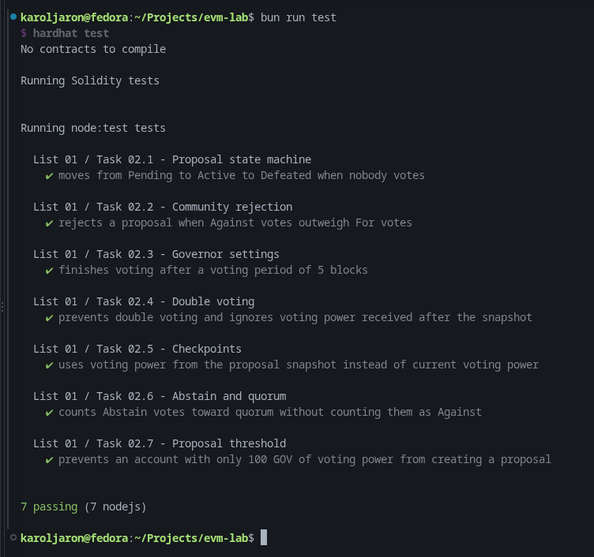

# List 01

The exercises from this list are implemented as automated tests.

Tests:

[`test/list-01/`](../../test/list-01/)

## Covered tasks

- Proposal state machine
- Community rejection
- Governor settings
- Double voting
- Checkpoints
- Abstain and quorum
- Proposal threshold

## Test result

